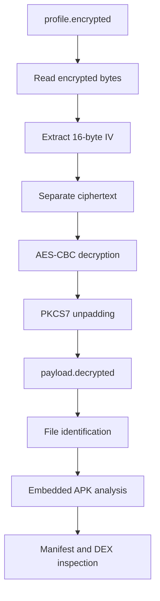
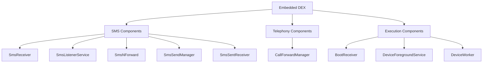

# Embedded Payload Analysis — RBL Card Limit Increase

## 1. Investigation Objective

This report documents the recovery and static examination of an embedded Android application payload identified during the investigation of `RBL CARD LIMIT UPDATE.apk`.

The analysis focuses on:

- Payload recovery and decryption methodology.
- Identification of the recovered APK.
- Embedded application structure.
- DEX metadata and component references.
- Security-relevant implementation areas.
- Evidence integrity and analytical limitations.

The investigation distinguishes the original application, encrypted payload, decrypted payload, and extracted analysis artifacts.

## 2. Payload Evidence Inventory

The following artifacts were identified under `recovery/payload_analysis/`.

| Artifact | File size | Description |
|---|---:|---|
| `profile.encrypted` | 4,367,984 bytes | Encrypted input used by the recovery script |
| `profile.extracted` | 4,367,984 bytes | Extracted artifact |
| `payload.decrypted` | 4,367,966 bytes | Recovered Android APK |
| `inner_apk/AndroidManifest.xml` | 32,400 bytes | Embedded APK binary manifest |
| `inner_apk/classes.dex` | 4,386,144 bytes | Dalvik executable |
| `inner_apk/resources.arsc` | 1,372,792 bytes | Android compiled resources |

## 3. Payload Recovery Methodology

### 3.1 Recovery script

The investigation includes a Python recovery script:

`recovery/payload_analysis/decrypt_static.py`

The script uses the Python `cryptography` library and implements AES-CBC decryption with PKCS7 padding.

The observed processing logic is:

1. Read the encrypted input file.
2. Separate the first 16 bytes as the initialization vector.
3. Treat the remaining bytes as ciphertext.
4. Decrypt using AES-CBC.
5. Remove PKCS7 padding.
6. Write the plaintext to a new output file.
7. Calculate and print its SHA-256 digest.

### 3.2 Relevant code excerpt

The following is a sanitized excerpt of the recovery implementation. The cryptographic key is intentionally excluded.

```python
from pathlib import Path
from hashlib import sha256
from cryptography.hazmat.primitives.ciphers import (
    Cipher, algorithms, modes
)
from cryptography.hazmat.primitives.padding import PKCS7

src = Path("recovery/payload_analysis/profile.encrypted")
dst = Path("recovery/payload_analysis/payload.decrypted")

data = src.read_bytes()

iv = data[:16]
ciphertext = data[16:]

decryptor = Cipher(
    algorithms.AES(key),
    modes.CBC(iv)
).decryptor()

padded = decryptor.update(ciphertext) + decryptor.finalize()

unpadder = PKCS7(128).unpadder()
plaintext = unpadder.update(padded) + unpadder.finalize()

with dst.open("xb") as f:
    f.write(plaintext)

print("SHA-256:", sha256(plaintext).hexdigest())
```

**Security note:** The original recovery script contains a hardcoded cryptographic key. The key must remain outside the public repository. The published excerpt is not intended to be a directly executable replacement for the original script.

### 3.3 Recovery process

The observed recovery process can be represented as follows:



This diagram represents the recovery script's processing logic, not a claim about the application's runtime execution.

## 4. Recovered Payload Identification

The recovered artifact was examined using the Linux `file` utility.

Command:

```bash
file recovery/payload_analysis/payload.decrypted
```

Observed output:

```text
Android package (APK), with APK Signing Block
```

This establishes that the recovered file was recognized as an Android application package.

The SHA-256 hash recorded during the investigation is:

```text
712ec1d0018c5e45e6472e585f6e989618567a4fdf059b753f221472c1d91056
```

This hash identifies the recovered payload and must not be confused with the original APK's SHA-256 digest.

## 5. Embedded Application Metadata

The existing `inner_badging.txt` output reports:

| Attribute | Observed value |
|---|---|
| Package name | `com.rblcard_jagtd` |
| Version code | 1 |
| Version name | 1.0 |
| Minimum SDK | 25 |
| Target SDK | 34 |
| Compile SDK | 35 |
| Platform build version | 15 |
| Application label | RBL CARD LIMIT INCREASE |

The embedded DEX and manifest string data also expose component class names under the namespace:

`com.nxtwave.berlinenxt`

These are component implementation namespaces and should not be confused with the package identity reported by the metadata extraction.

## 6. DEX Analysis

The extracted DEX artifact was identified as:

```text
Dalvik dex file version 037
```

Its recorded SHA-256 digest is:

```text
194a87a57ea06786ce036858934f3f7ae53d91c0f2a3e2a715aa9f0979e3c073
```

The DEX was examined using JADX and Baksmali-related analysis outputs.

The investigation identified references to several security-relevant classes.

### 6.1 Identified component classes

| Component | Observed class |
|---|---|
| Boot receiver | `com.nxtwave.berlinenxt.BootReceiver` |
| Call forwarding manager | `com.nxtwave.berlinenxt.CallForwardManager` |
| Foreground service | `com.nxtwave.berlinenxt.DeviceForegroundService` |
| Background worker | `com.nxtwave.berlinenxt.DeviceWorker` |
| SMS listener service | `com.nxtwave.berlinenxt.SmsListenerService` |
| SMS-related service | `com.nxtwave.berlinenxt.SmsNForward` |
| SMS receiver | `com.nxtwave.berlinenxt.SmsReceiver` |
| SMS sending service | `com.nxtwave.berlinenxt.SmsSendManager` |
| SMS sent receiver | `com.nxtwave.berlinenxt.SmsSentReceiver` |

These names were identified in the existing priority class report and DEX analysis outputs.

### 6.2 Component relationships

The identified classes suggest several areas requiring deeper examination:

- SMS reception and processing.
- SMS transmission.
- Telephony and call-forwarding operations.
- Boot-event handling.
- Foreground and background execution.

The following diagram summarizes the identified component groups. It does not establish their actual runtime call relationships.



## 7. Device Identifier Reference

The existing DEX disassembly contains a method named `getDeviceId()`.

The observed instruction sequence includes:

```smali
iget-object v0, v2, Li2/m;->a Lcom/nxtwave/berlinenxt/MainActivity;

invoke-virtual v0, Landroid/content/Context;->getContentResolver()Landroid/content/ContentResolver;

const-string v1, "android_id"

invoke-static v0, v1, Landroid/provider/Settings$Secure;->getString(Landroid/content/ContentResolver; Ljava/lang/String;)Ljava/lang/String;

move-result-object v0

return-object v0
```

This code references Android's `Settings.Secure` API and the `android_id` setting.

It establishes that the analyzed method contains a device-identifier retrieval path. It does not establish whether the identifier was transmitted to a remote server.

## 8. DEX Decompilation Limitations

The existing JADX output contains multiple decoding exceptions.

Examples include:

- Invalid buffer positions exceeding the DEX file limit.
- Negative buffer positions.
- Methods that could not be reconstructed.
- Generated Java methods containing `UnsupportedOperationException` placeholders.

These errors limit the reliability of reconstructed Java source for affected methods.

Consequently:

- Class-name references are retained as observed evidence.
- Available disassembly instructions are preferred over incomplete reconstructed Java.
- Method behaviour is not inferred solely from class names.
- Further examination of raw DEX instructions is required for affected methods.

## 9. Cryptographic Integrity Results

The following SHA-256 values were recorded during the investigation.

| Artifact | SHA-256 |
|---|---|
| `payload.decrypted` | `712ec1d0018c5e45e6472e585f6e989618567a4fdf059b753f221472c1d91056` |
| `profile.encrypted` | `ea23e8aa7cacad69f821ef873d10488ee13ac058e9a762288afb2b60b0c0a8d4` |
| `profile.extracted` | `ea23e8aa7cacad69f821ef873d10488ee13ac058e9a762288afb2b60b0c0a8d4` |
| `inner_apk/classes.dex` | `194a87a57ea06786ce036858934f3f7ae53d91c0f2a3e2a715aa9f0979e3c073` |

The identical hashes of `profile.encrypted` and `profile.extracted` establish that these two files are byte-identical.

The decrypted payload has a different hash and a different reported size.

## 10. Security-Relevant Observations

The recovered DEX exposes references to components associated with SMS, telephony, boot events, and background execution.

The recovered APK also contains a method referencing Android's `ANDROID_ID` setting.

These observations identify important areas for continued investigation:

1. SMS reception and message-processing logic.
2. SMS transmission and delivery-result handling.
3. Call-forwarding implementation.
4. Device identifier usage.
5. Boot receiver and foreground-service behaviour.
6. Backend communication and data transmission.

These findings establish the presence of relevant code and component references, not successful malicious execution.

## 11. Limitations

The current analysis does not independently establish:

- Whether the recovered payload was dynamically loaded or executed.
- Whether the identified services were successfully started.
- Whether SMS messages were transmitted or forwarded.
- Whether call forwarding was successfully configured.
- Whether device identifiers were transmitted externally.
- Whether the embedded APK was installed on a device.
- Whether the identified components were triggered during runtime.

Further code-level correlation and runtime evidence are required.

## 12. Conclusion

The investigation recovered an Android APK from the encrypted payload processing workflow.

The recovered artifact contains a DEX file with component references associated with SMS handling, telephony, background execution, and boot-event processing.

The embedded application metadata reports package identity `com.rblcard_jagtd`, while several identified component classes use the namespace `com.nxtwave.berlinenxt`.

The recovered DEX also contains a method referencing Android's `ANDROID_ID` setting.

These findings provide a foundation for the next stage of investigation: detailed examination of SMS-related implementation paths and their relationship with the identified telephony and backend components.

## 13. Evidence Handling

Original evidence and recovered artifacts must remain preserved.

For public repository publication:

- Do not upload original APKs or recovered payload binaries.
- Do not publish cryptographic keys or private configuration values.
- Do not upload unsanitized Firebase logs or backend configuration files.
- Retain SHA-256 hashes and sanitized analysis excerpts.
- Preserve the original recovery script privately and publish only a sanitized version where appropriate.