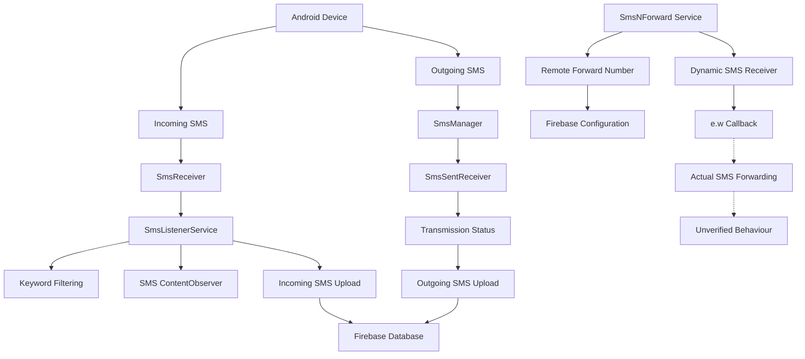

# SMS Functionality Analysis

## 1. Executive Summary

The application presenting itself as **RBL Card Limit Increase** contains multiple SMS-related components that implement incoming SMS monitoring, outgoing SMS transmission, message processing, device identification, and Firebase-based data upload functionality.

Static analysis identified:

- Incoming SMS reception through broadcast receivers.
- SMS database monitoring using a `ContentObserver`.
- Keyword-based message filtering.
- Incoming and outgoing SMS upload routines.
- Outgoing SMS transmission, including multipart messages.
- SIM-specific SMS manager selection.
- SMS transmission status monitoring.
- A separate service responsible for configuring a forwarding number through Firebase Realtime Database.

The application demonstrates substantial access to SMS functionality and remote communication capabilities.

**Important limitation:** The callback associated with the dynamically registered receiver could not be reconstructed because of DEX decoding errors. Consequently, actual forwarding of received SMS messages to the configured forwarding number remains unverified.

This assessment is based on static code analysis. It does not establish that the identified functionality was executed successfully on a device.

---

## 2. Investigation Scope

The investigation focused on identifying SMS-related capabilities, tracing relevant application components, and determining how message data is processed and transmitted.

### Objectives

1. Identify incoming SMS reception mechanisms.
2. Identify outgoing SMS transmission functionality.
3. Examine message collection and filtering logic.
4. Trace SMS-related Firebase upload operations.
5. Examine SIM selection and multipart SMS handling.
6. Investigate remote forwarding-number configuration.
7. Determine whether incoming messages are actually forwarded to a configured destination.

### Evidence examined

| Evidence | Description |
|---|---|
| `targeted_sms_worker.txt` | Targeted SMS-related DEX analysis |
| `priority_methods_full.txt` | Extracted priority methods and application logic |
| `inner_jadx/sources/` | JADX-generated Java source output |
| `inner_smali/` | Baksmali output |
| `worker_smali/` | Additional Baksmali output |
| `inner_apk/classes.dex` | Recovered DEX file |

### DEX identity

| Property | Value |
|---|---|
| File | `classes.dex` |
| Format | Dalvik Executable |
| DEX version | 037 |
| Size | 4,386,144 bytes |
| SHA-256 | `194a87a57ea06786ce036858934f3f7ae53d91c0f2a3e2a715aa9f0979e3c073` |

---

## 3. Outgoing SMS Transmission

### 3.1 Identified component

`i2.s` — `run()V`

Static inspection of this method identified an outgoing SMS transmission routine.

The method retrieves relevant values from its instance fields, including:

- Destination telephone number.
- SIM selection index.
- Message content.
- Associated command or metadata fields.

The implementation checks whether the application has the `SEND_SMS` permission before attempting transmission.

### 3.2 Transmission logic

The identified implementation uses Android's `SmsManager` API.

Two transmission paths were identified:

**Single-part SMS**

For messages up to 160 characters, the application invokes:

```java
smsManager.sendTextMessage(
    destination,
    null,
    message,
    sentIntent,
    deliveryIntent
);
```

**Multipart SMS**

For longer messages, the application invokes:

```java
ArrayList<String> parts =
    smsManager.divideMessage(message);

smsManager.sendMultipartTextMessage(
    destination,
    null,
    parts,
    sentIntents,
    deliveryIntents
);
```

The application also constructs `PendingIntent` objects for SMS transmission callbacks.

### 3.3 SIM selection

The helper method:

`y0.e.w(I)`

was identified as responsible for obtaining an appropriate `SmsManager`.

The implementation references:

- `SubscriptionManager`
- `getActiveSubscriptionInfoList()`
- Subscription identifiers
- `SmsManager.getSmsManagerForSubscriptionId()`
- `SmsManager.getDefault()` as a fallback

This indicates support for selecting an active SIM subscription when sending SMS messages.

### 3.4 Assessment

<badge color="success">Confirmed through static analysis</badge>

The application contains functionality capable of initiating outgoing SMS transmissions.

However, the presence of these API calls does not establish successful carrier delivery or recipient receipt.

---

## 4. Incoming SMS Reception

### 4.1 Identified component

`SmsReceiver`

The recovered source identifies an incoming SMS broadcast receiver.

Its reconstructed method contains a JADX decoding error, so the complete receiver implementation was not available.

Nevertheless, the previously extracted method evidence identifies handling of the `SMS_RECEIVED` broadcast, PDU-related extras, sender information, and initiation of `SmsListenerService`.

### 4.2 Processing service

`SmsListenerService`

The service is associated with incoming and outgoing SMS processing.

The extracted implementation identifies the following operations:

- Starting a single-thread executor.
- Creating a `HandlerThread` named `SmsProcessor`.
- Creating a `Handler`.
- Acquiring a wake lock with a 600,000 ms timeout.
- Registering a `ContentObserver` against `Telephony.Sms.CONTENT_URI`.
- Starting a foreground service.
- Unregistering the observer and releasing resources during destruction.

The service also uses `Settings.Secure.getString()` to retrieve the Android ID.

A fallback identifier of the form `unknown_<timestamp>` is used when the device identifier is unavailable.

### 4.3 Keyword filtering

The extracted implementation contains the following keywords:

- `otp`
- `credited`
- `spent`
- `purchased`

The message-processing logic normalizes message text to lowercase before checking for these terms.

The service also stores processed SMS identifiers in SharedPreferences under:

`processed_sms_ids`

The collection is subject to a size-management mechanism when it grows beyond approximately 2,000 entries.

### 4.4 Assessment

<badge color="success">Confirmed through static analysis</badge>

The application contains incoming SMS processing and keyword-based filtering functionality.

The identified keywords are consistent with monitoring messages associated with authentication and financial transactions. This is a behavioural observation, not proof of a specific criminal purpose.

---

## 5. SMS Data Collection and Firebase Upload

### 5.1 Incoming SMS upload

The extracted incoming-message upload routine constructs message-related fields including:

| Field | Description |
|---|---|
| `timestamp_ms` | Message timestamp in milliseconds |
| `device_id` | Device identifier |
| `indian_time` | Time-related metadata |
| `received_at` | Incoming message receipt metadata |

The routine constructs a Firebase-style database path:

```text
users/{device_id}/all_sms/{message_key}
```

A task failure listener is also present, with an associated error log:

```text
Error in uploadIncomingSms
```

### 5.2 Outgoing SMS upload

A separate outgoing-message upload routine constructs fields including:

| Field | Description |
|---|---|
| `timestamp_ms` | Message timestamp |
| `device_id` | Device identifier |
| `indian_time` | Time-related metadata |
| `sent_at` | Outgoing message metadata |
| `message_id` | Message identifier |
| `message_type` | Message classification |

The routine references the same general Firebase database structure:

```text
users/{device_id}/all_sms/{message_key}
```

The existence of these routines establishes an application-level SMS upload pathway. Successful remote storage was not independently verified.

### 5.3 Assessment

<badge color="success">Upload routines identified</badge>

The application contains separate processing paths for incoming and outgoing SMS data, with Firebase-style database references.

The static evidence establishes the intended upload implementation, not successful exfiltration or the actual contents of a live remote database.

---

## 6. Outgoing SMS Status Monitoring

### 6.1 Identified component

`SmsSentReceiver`

The extracted `onReceive()` method retrieves:

- `recipient`
- `message`
- `timestamp`

It then checks the broadcast result code and maps the result into status strings.

Identified status values include:

| Status | Meaning |
|---|---|
| `sent_success` | SMS transmission reported as successful by the callback |
| `failed_no_service` | No service |
| `failed_null_pdu` | Null PDU |
| `failed_radio_off` | Radio unavailable |
| `failed_generic` | Generic transmission failure |

The receiver subsequently starts `SmsListenerService` with the outgoing message details and status.

### 6.2 Assessment

<badge color="success">Confirmed through static analysis</badge>

The application contains a mechanism for tracking outgoing SMS transmission results.

A successful callback does not independently establish delivery to the final recipient.

---

## 7. Remote SMS Forwarding Configuration

### 7.1 Identified component

`SmsNForward`

The extracted service evidence identifies a separate mechanism for managing a forwarding number.

The service references:

- SharedPreferences named `SmsForwardPrefs`.
- A preference key named `forward_number`.
- Firebase Realtime Database.
- A background `HandlerThread` named `SmsForwardThread`.
- The Android device identifier.

The service reads a previously saved forwarding number and maintains an enabled-state indicator based on whether a valid value is available.

### 7.2 Identified commands

The extracted command-handling evidence identifies the following actions:

| Command | Observed operation |
|---|---|
| `CHECK_FORWARD_NUMBER` | Forwarding-number check operation |
| `STOP_FORWARDING` | Stop-forwarding operation |
| `UPDATE_FORWARD_NUMBER` | Updates the configured forwarding number |
| `CLEAR_FORWARD_NUMBER` | Writes an empty value to the forwarding-number path |

The update and clear operations reference:

```text
number/forward_number
```

The service also registers a receiver for:

```text
android.provider.Telephony.SMS_RECEIVED
```

The registration evidence identifies a receiver priority of 1000.

### 7.3 Unresolved callback

The dynamically registered receiver is referenced through the obfuscated class:

```text
e.w
```

JADX generated a Java stub for this class but failed to reconstruct its methods.

The following methods could not be decoded:

- `e.w.<init>()`
- `e.w.a(String, String)`
- `e.w.onReceive(Context, Intent)`

The errors included invalid DEX instruction positions, such as:

```text
newPosition < 0
newPosition > limit
```

The class was not recovered in either the available `inner_smali` or `worker_smali` output.

Additionally, the `SmsNForward` service itself contains several method decoding failures.

### 7.4 Forensic interpretation

The available evidence establishes:

1. A service responsible for managing a forwarding number.
2. Remote configuration operations involving that number.
3. Registration of an SMS_RECEIVED broadcast receiver.

However, the receiver's callback could not be reconstructed.

Therefore, the following behaviour has **not been established**:

- Whether the receiver extracts incoming SMS message content.
- Whether it uses the configured forwarding number as a destination.
- Whether it invokes `SmsManager` to transmit received messages.
- Whether any such forwarding succeeds at runtime.

The presence of a forwarding-number configuration mechanism must not be treated as proof of actual SMS forwarding.

---

## 8. SMS-Related Android Permissions

The recovered application metadata identifies the following SMS-related permissions:

| Permission | Capability |
|---|---|
| `android.permission.RECEIVE_SMS` | Receive SMS broadcasts |
| `android.permission.READ_SMS` | Read SMS data |
| `android.permission.SEND_SMS` | Initiate SMS transmission |
| `android.permission.RECEIVE_MMS` | Receive MMS-related broadcasts |
| `android.permission.READ_PHONE_STATE` | Access certain telephony state |
| `android.permission.READ_PHONE_NUMBERS` | Access available phone-number information |
| `android.permission.CALL_PHONE` | Initiate phone calls |

Permission declarations establish requested capabilities, not proof that the permissions were granted or exercised.

---

## 9. Consolidated Findings

| ID | Finding | Evidence status |
|---|---|---|
| SMS-01 | Outgoing SMS transmission through `SmsManager` | Confirmed |
| SMS-02 | Multipart SMS transmission | Confirmed |
| SMS-03 | SIM-specific SMS manager selection | Confirmed |
| SMS-04 | Incoming SMS receiver implementation references | Confirmed, callback partially unrecovered |
| SMS-05 | SMS database monitoring using `ContentObserver` | Confirmed |
| SMS-06 | Keyword-based SMS filtering | Confirmed |
| SMS-07 | Incoming SMS Firebase upload routine | Confirmed |
| SMS-08 | Outgoing SMS Firebase upload routine | Confirmed |
| SMS-09 | Outgoing SMS status monitoring | Confirmed |
| SMS-10 | Remote forwarding-number configuration | Confirmed |
| SMS-11 | Actual forwarding of incoming SMS to configured number | Unverified |

---

## 10. Security Assessment

The combined SMS-related functionality presents several security concerns.

### 10.1 Potential exposure of sensitive messages

The application contains logic for collecting incoming and outgoing SMS data and preparing it for remote upload.

SMS messages can contain:

- One-time passwords.
- Banking notifications.
- Transaction information.
- Account recovery codes.
- Personal communications.

If these routines execute and the remote upload succeeds, sensitive information could be exposed to an external service.

### 10.2 Remote communication and control

The forwarding-number configuration mechanism indicates that the application supports remote configuration of a phone number through Firebase-related operations.

This warrants further investigation into the application's backend communication and command-handling mechanisms.

### 10.3 SMS transmission capability

The outgoing SMS implementation can initiate messages using the Android SMS API.

This capability could potentially be abused to transmit messages without the user's awareness if the application has the required permission and its sending routines are invoked.

The actual runtime behaviour and authorization context remain outside the scope of this static analysis.

### 10.4 Overall assessment

The combination of SMS monitoring, message processing, remote upload routines, outgoing SMS transmission, and remote forwarding-number configuration represents a significant privacy and security concern.

The investigation does not establish the exact operational purpose of every component or prove successful data exfiltration.

---

## 11. Technical Limitations

The following limitations must remain part of the final research record:

1. The analysis was based on recovered DEX, JADX output, Baksmali output, and extracted method evidence.
2. Several methods in `SmsNForward` and the obfuscated receiver `e.w` could not be reconstructed.
3. The decoding errors prevented a complete examination of the receiver callback.
4. Actual forwarding of incoming SMS messages to the configured number remains unverified.
5. Successful Firebase uploads were not independently confirmed.
6. Successful SMS delivery to recipients was not independently confirmed.
7. Runtime execution of the identified SMS functionality was not established by this analysis.

These limitations do not invalidate the behaviours directly identified in the recovered code, but they restrict conclusions about runtime execution and the unresolved forwarding mechanism.

---

## 12. Final Conclusion

Static analysis identified extensive SMS-related functionality in the application presenting itself as RBL Card Limit Increase.

The recovered implementation includes incoming SMS processing, keyword filtering, SMS database monitoring, outgoing SMS transmission, multipart messaging, SIM-specific transmission handling, SMS status monitoring, and Firebase-based upload routines.

A separate service manages a remotely configured forwarding number and registers an additional SMS receiver.

However, due to DEX decoding failures affecting the obfuscated receiver `e.w`, the precise behaviour of that callback could not be established. Consequently, actual SMS forwarding to the configured number remains an unresolved finding.

**Final assessment:** The application contains substantial SMS access, processing, transmission, and remote communication capabilities. These capabilities create a potential risk to user privacy and SMS confidentiality. Runtime behaviour and successful remote data transfer require separate validation.

**SMS investigation status: CLOSED — static analysis completed with one explicitly documented unresolved behaviour.**

---

## 13. Evidence Preservation

The following identifiers should be retained with the investigation:

| Evidence item | Identifier |
|---|---|
| Recovered DEX | `inner_apk/classes.dex` |
| DEX SHA-256 | `194a87a57ea06786ce036858934f3f7ae53d91c0f2a3e2a715aa9f0979e3c073` |
| JADX receiver stub | `inner_jadx/sources/e/w.java` |
| SMS service source | `inner_jadx/sources/com/nxtwave/berlinenxt/SmsNForward.java` |
| SMS receiver source | `inner_jadx/sources/com/nxtwave/berlinenxt/SmsReceiver.java` |
| SMS sent receiver source | `inner_jadx/sources/com/nxtwave/berlinenxt/SmsSentReceiver.java` |
| Primary method evidence | `targeted_sms_worker.txt` |
| Additional method evidence | `priority_methods_full.txt` |

Original evidence and recovered artifacts should be retained unchanged. Any public release should exclude private device identifiers, credentials, sensitive backend configuration, and cryptographic secrets.

---

## 14. SMS Processing Architecture

The following diagram represents the identified application-level processing paths. The forwarding branch is deliberately marked unresolved.



**Report classification:** Static Android SMS behaviour analysis. No claim of confirmed runtime execution or successful remote exfiltration.