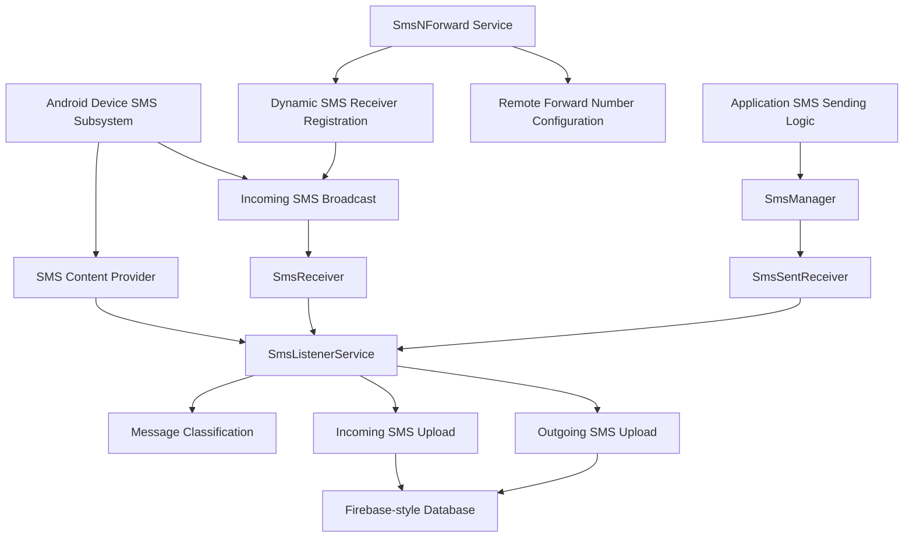

# SMS Analysis — RBL Card Limit Increase Android Application

## 1. Objective

This analysis examines SMS-related functionality identified in the recovered application payload through DEX disassembly and static code inspection.

The investigation focuses on:

- Outgoing SMS transmission.
- Incoming SMS reception and processing.
- SMS database observation.
- Collection and remote upload of SMS metadata and content.
- SMS forwarding configuration and remote control.
- USSD-related functionality.

The findings are based on static evidence. No claim of successful runtime execution or message delivery is made.

## 2. Evidence Sources

| Evidence file | Purpose |
|---|---|
| `targeted_sms_worker.txt` | SMS transmission and SIM selection implementation |
| `priority_methods_full.txt` | SMS listener, receiver and forwarding service implementation |
| `inner_permissions.txt` | Recovered payload permission references |
| `inner_badging.txt` | Application package metadata |

Relevant implementation classes:

- `Lcom/nxtwave/berlinenxt/SmsListenerService;`
- `Lcom/nxtwave/berlinenxt/SmsNForward;`
- `Lcom/nxtwave/berlinenxt/SmsReceiver;`
- `Lcom/nxtwave/berlinenxt/SmsSendManager;`
- `Lcom/nxtwave/berlinenxt/SmsSentReceiver;`

These classes belong to the `com.nxtwave.berlinenxt` implementation namespace. This is distinct from the recovered APK package identity, `com.rblcard_jagtd`.

## 3. Outgoing SMS Transmission

### 3.1 Permission verification

The SMS sending implementation explicitly checks:

```java
android.permission.SEND_SMS
```

The disassembly shows a permission check before obtaining an `SmsManager` instance.

If permission is unavailable, the code records:

```text
SEND_SMS permission not granted
```

This establishes an explicit permission-dependent SMS transmission path.

### 3.2 SIM selection

The method:

```text
w(I)Landroid/telephony/SmsManager;
```

uses Android's `SubscriptionManager` to retrieve active subscription information.

It then obtains an SMS manager using:

```java
SmsManager.getSmsManagerForSubscriptionId(subscriptionId);
```

A fallback to:

```java
SmsManager.getDefault();
```

is also present.

This indicates support for selecting an SMS subscription, with a fallback to the default SMS manager.

### 3.3 Single-part and multipart messages

The implementation checks message length against 160 characters.

For longer messages, it uses:

```java
ArrayList<String> parts =
    smsManager.divideMessage(message);

smsManager.sendMultipartTextMessage(
    destination,
    null,
    parts,
    sentIntents,
    null
);
```

For shorter messages, it uses:

```java
smsManager.sendTextMessage(
    destination,
    null,
    message,
    sentIntent,
    null
);
```

The actual implementation is represented by DEX instructions rather than the illustrative Java reconstruction above.

### 3.4 Transmission observations

The implementation contains logging strings including:

```text
Sending SMS to:
SMS sent successfully
Multipart SMS sent
Failed to get SmsManager for SIM
Error sending SMS
```

**Assessment:** Outgoing SMS transmission is directly established at the code level. Successful carrier delivery, recipient receipt and runtime execution remain unverified.

## 4. Incoming SMS Reception

### 4.1 Broadcast handling

The `SmsReceiver` class contains an `onReceive()` method that checks for:

```java
android.provider.Telephony.SMS_RECEIVED
```

It then retrieves the broadcast extras and accesses:

```java
pdus
```

The PDU array is processed to obtain incoming message information.

The disassembly also contains the log string:

```text
SMS Received from:
```

### 4.2 Service handoff

The receiver constructs an intent targeting:

```text
SmsListenerService
```

It supplies message-related information, including:

```text
type = incoming
sender = ...
```

This demonstrates a code path that hands incoming SMS information to a dedicated service for further processing.

### 4.3 Incoming SMS processing

The listener service contains message classification logic.

Its static initialization builds a keyword set containing terms such as:

- `otp`
- `credited`
- `spent`
- `purchased`

The service also contains a method that converts message text to lowercase and checks it against the keyword set.

**Assessment:** Incoming SMS reception, extraction and keyword-based classification are directly supported by the disassembly.

The presence of these keywords alone does not establish the exact business purpose of the classification logic.

## 5. SMS Database Monitoring

The `SmsListenerService.onCreate()` method contains the following Android API references:

```java
ContentResolver resolver = getContentResolver();

Uri smsUri = Telephony.Sms.CONTENT_URI;

resolver.registerContentObserver(
    smsUri,
    true,
    smsObserver
);
```

This is a conceptual reconstruction of the observed instructions.

The service registers a `ContentObserver` against the SMS content URI.

The corresponding cleanup logic in `onDestroy()` unregisters the observer.

This indicates that the application has a mechanism to monitor changes to the device's SMS content provider.

The observed code also initializes:

- A background executor.
- A `HandlerThread` named `SmsProcessor`.
- A `Handler`.
- A timed `WakeLock`.

These components provide background processing infrastructure.

**Assessment:** SMS content-provider observation is directly established. The exact range of messages accessible to the application depends on Android permissions, platform restrictions and runtime conditions.

## 6. SMS Data Collection and Remote Upload

This is one of the most significant findings.

### 6.1 Incoming SMS upload

The listener service constructs a data object containing fields including:

| Field | Observed purpose |
|---|---|
| `timestamp_ms` | Message timestamp |
| `device_id` | Device identifier |
| `indian_time` | Formatted time |
| `received_at` | Processing or receipt timestamp |

The implementation then accesses a Firebase-style database reference:

```text
users/{device_id}/all_sms/{message_key}
```

The disassembly contains references to:

```java
databaseReference.child("users")
    .child(deviceId)
    .child("all_sms")
    .child(messageKey);
```

The actual application uses obfuscated and library-specific method calls; this is a conceptual representation.

An asynchronous task is created, with a failure listener attached.

The method also contains the error string:

```text
Error in uploadIncomingSms
```

### 6.2 Outgoing SMS upload

A separate method constructs an outgoing SMS record.

Observed fields include:

| Field | Observed purpose |
|---|---|
| `timestamp_ms` | Message timestamp |
| `device_id` | Device identifier |
| `indian_time` | Formatted time |
| `sent_at` | Processing or send timestamp |
| `message_id` | Message identifier |
| `message_type` | Classified message type |

It accesses the same database path structure:

```text
users/{device_id}/all_sms/{message_key}
```

The implementation contains the error string:

```text
Error in uploadOutgoingSms
```

### 6.3 Device identification

During service initialization, the code retrieves:

```java
Settings.Secure.getString(
    getContentResolver(),
    "android_id"
);
```

The resulting value is stored in the service's device identifier field and used when constructing the database path.

If the value is unavailable or empty, fallback identifier logic is present.

**Assessment:** The code contains separate incoming and outgoing SMS data-upload routines using a device-specific Firebase-style database path. The data structures and upload calls are directly observed.

Successful remote upload, backend ownership, access permissions and actual collection of a victim's messages have not been independently verified.

## 7. SMS Forwarding Service

### 7.1 Service initialization

The application contains:

```text
SmsNForward
```

The service initializes:

- A background `HandlerThread`.
- A `Handler`.
- Shared preferences named `SmsForwardPrefs`.
- A Firebase database reference.

### 7.2 Forwarding number configuration

The service reads a preference named:

```text
forward_number
```

It stores the configured value in an internal field and maintains a Boolean forwarding-enabled state.

The disassembly contains the log message:

```text
Loaded saved forward number:
```

It also contains:

```text
Forwarding enabled:
```

### 7.3 Remote configuration

The service registers a listener against a database reference containing:

```text
number
```

The service also contains command-handling logic involving:

```text
STOP_FORWARDING
CLEAR_FORWARD_NUMBER
```

Another code path writes a supplied `forward_number` value to the remote database.

This establishes a remotely configurable forwarding-related service.

### 7.4 Dynamic SMS receiver registration

The service creates an intent filter for:

```java
android.provider.Telephony.SMS_RECEIVED
```

It sets the broadcast priority to:

```java
1000
```

It then registers a broadcast receiver dynamically.

The service also contains cleanup logic to unregister that receiver.

**Assessment:** A dynamically registered SMS receiver and remotely configurable forwarding-number mechanism are directly observed.

However, the supplied disassembly excerpt does not establish the complete forwarding operation that transfers each received SMS to the configured destination number. That specific data path requires further method-level inspection.

## 8. SMS Sent Receiver

The `SmsSentReceiver` implementation contains a handoff to `SmsListenerService`.

It supplies:

```text
type = outgoing
```

This is consistent with the separate outgoing SMS processing and upload method.

The presence of this receiver supports the application's outgoing-message tracking architecture.

It does not independently prove that every message sent through the device is captured.

## 9. USSD Analysis

The supplied search was performed against:

```text
targeted_sms_worker.txt
priority_methods_full.txt
```

Search terms:

```text
sendUssdRequest
USSD
CALL_PHONE
TelephonyManager
```

No matching output was returned.

Therefore, the supplied evidence does not establish a USSD execution path.

This is a limited negative result: it does not prove that no USSD functionality exists elsewhere in the recovered payload.

## 10. Relevant Android Permissions

The outer application permission inventory includes:

| Permission | Relevance |
|---|---|
| `SEND_SMS` | Outgoing SMS transmission |
| `RECEIVE_SMS` | Incoming SMS reception |
| `READ_SMS` | SMS access |
| `READ_PHONE_STATE` | Telephony-related device information |
| `READ_PHONE_NUMBERS` | Phone-number-related information |
| `INTERNET` | Network communication |

Permission declarations indicate requested capabilities, not proof that Android granted them or that the application exercised them.

## 11. Security Assessment

| Finding | Evidence strength | Assessment |
|---|---|---|
| Outgoing SMS API calls | Direct DEX references | Confirmed code capability |
| Multipart SMS transmission | `divideMessage()` and `sendMultipartTextMessage()` | Confirmed code capability |
| SIM-specific SMS manager | Subscription manager and SMS manager calls | Confirmed code capability |
| Incoming SMS broadcast handling | `SMS_RECEIVED` and PDU extraction | Confirmed code capability |
| SMS content monitoring | `Telephony.Sms.CONTENT_URI` observer | Confirmed code capability |
| Incoming SMS remote upload | `uploadIncomingSms` and database path | Confirmed code path |
| Outgoing SMS remote upload | `uploadOutgoingSms` and database path | Confirmed code path |
| Remote forwarding configuration | `forward_number` and database listener | Confirmed configuration mechanism |
| Actual SMS forwarding to configured number | Complete message-to-destination path not established | Requires further analysis |
| USSD execution | No matching output in supplied files | Not established |

### Overall interpretation

The recovered application contains a substantial SMS-processing subsystem.

The combination of incoming SMS reception, SMS content observation, outgoing SMS transmission, device-specific remote SMS records and remotely configurable forwarding functionality raises significant privacy and security concerns.

The most important finding is not simply that the application requests SMS permissions. It is that the recovered code implements multiple SMS processing and remote data-transfer paths.

These capabilities warrant further investigation into the remote database, configuration controls and the exact forwarding implementation.

## 12. Limitations

This investigation is based on static DEX disassembly.

The following have not been established:

- Successful execution on a real Android device.
- Successful SMS transmission through a mobile carrier.
- Successful receipt of SMS messages by the application.
- Successful Firebase upload of message contents.
- The identity or ownership of the remote backend.
- Actual SMS forwarding to the configured number.
- Runtime permission grants.
- The complete behaviour of every obfuscated method.

Some application methods are obfuscated, and JADX output has previously shown decoding errors. Consequently, the DEX-level observations are preferred over unreliable reconstructed Java output.

## 13. Conclusion

Static analysis establishes that the recovered application implements outgoing SMS transmission, incoming SMS processing, SMS content-provider observation and separate incoming/outgoing SMS upload routines.

A further service implements remote forwarding-number configuration and dynamically registers for incoming SMS broadcasts.

These findings demonstrate potentially sensitive SMS collection and communication capabilities. Runtime analysis and complete forwarding-path inspection are necessary before making stronger claims about actual message exfiltration or forwarding.

---

## Appendix A — Evidence Handling

Preserve the original disassembly and evidence files.

Do not publish:

- Personal SMS contents.
- Real phone numbers.
- Device-specific identifiers.
- Firebase credentials or private configuration values.
- Access tokens or authentication material.

Keep any sensitive values redacted in the public repository.

## Appendix B — SMS Processing Architecture



**Diagram note:** This represents relationships established by static code references. It does not establish successful runtime execution or successful data transmission.