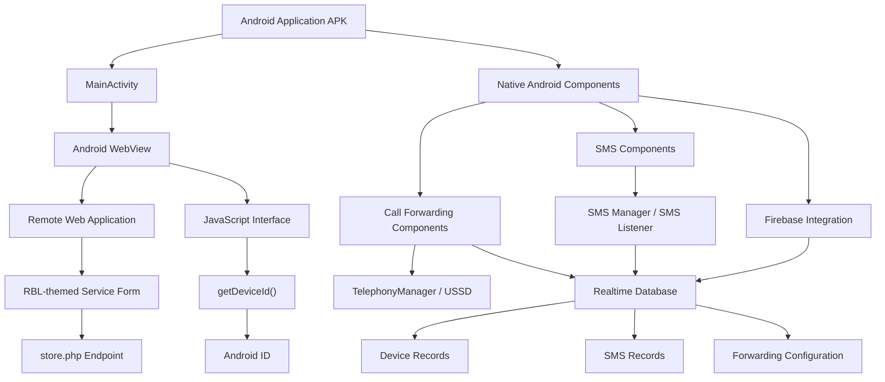
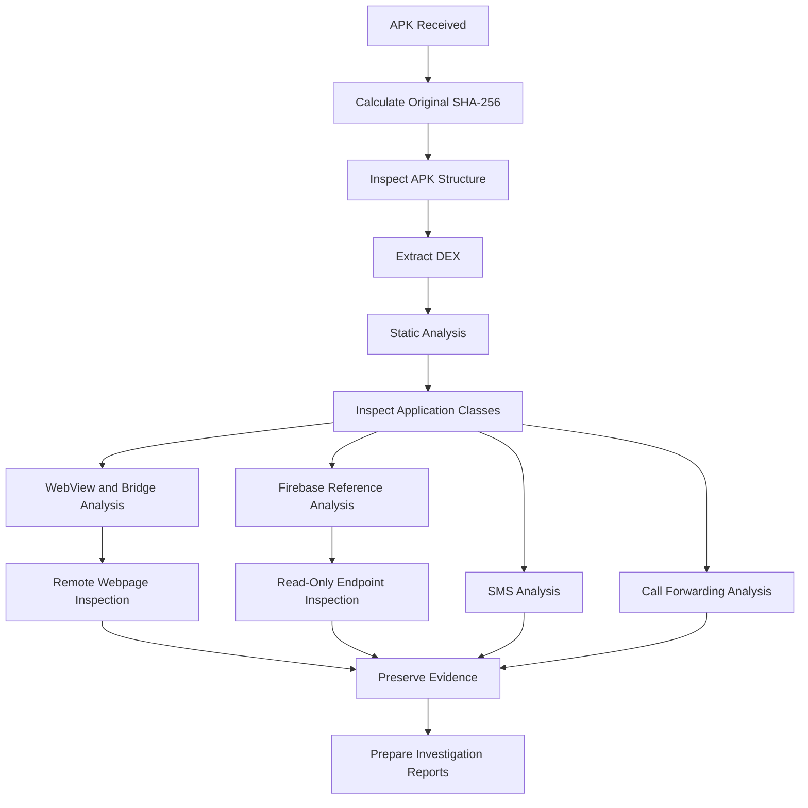

# RBL Card Limit Increase — Android APK Security Investigation

<p align="center">
  <strong>Android Malware Analysis | Mobile Forensics | Digital Forensics | Backend Security Assessment</strong>
</p>

<p align="center">
  
</p>

> **Investigation notice:** This repository documents a security investigation of an Android APK labelled **RBL CARD LIMIT INCREASE**. The investigation does not establish any affiliation between the application, its operators, or RBL Bank. The RBL branding is described only as observed application and webpage content.

---

## 1. Project Overview

This project documents the static analysis and security investigation of a suspicious Android application presenting itself as an RBL card limit increase service.

The investigation examines the application's internal structure, Android components, WebView implementation, JavaScript bridge, SMS-related functionality, call-forwarding functionality, Firebase-related implementation and remote web infrastructure.

A significant observation during the investigation was that a Firebase Realtime Database endpoint returned structured records containing sensitive information, including device metadata, SIM information, SMS records and administrative credential material.

The objective is to understand the application's architecture, identify potentially malicious or privacy-invasive capabilities, preserve investigation evidence, and document security implications through reproducible analysis.

### Investigation objectives

- Identify the APK's structure, package information and cryptographic identity.
- Examine DEX files and recover application implementation details.
- Identify sensitive Android permissions and application components.
- Investigate WebView and JavaScript-to-native communication.
- Analyse SMS-related application functionality.
- Analyse call-forwarding-related functionality.
- Investigate Firebase-related application references and database exposure.
- Identify indicators of compromise and suspicious infrastructure.
- Preserve evidence and document findings with cryptographic hashes.

---

## 2. Investigation Information

| Attribute | Value |
|---|---|
| Application label | RBL CARD LIMIT INCREASE |
| APK filename | `RBL CARD LIMIT UPDATE.apk` |
| Package identifier | `com.onnl.qapp.xtxr` |
| Application version observed | 1.0 |
| Platform | Android |
| Analysis environment | Kali Linux |
| Analysis approach | Static analysis and read-only endpoint inspection |
| Investigation status | Analysis reports prepared; some attribution questions remain open |

### Original APK SHA-256

```text
5f1f6e699667955bdcf8524170af48d1a1f50f3cc1d844ba4dd4daa830d7083b
```

### Recovered DEX SHA-256

```text
194a87a57ea06786ce036858934f3f7ae53d91c0f2a3e2a715aa9f0979e3c073
```

---

## 3. System Architecture

The application appears to combine native Android functionality with remote web content and backend communication.

The architecture below represents the components and relationships identified during the investigation. It is an analytical model, not a claim that every network interaction has been observed dynamically.

### 3.1 High-level architecture



**Architecture interpretation:**

- The native Android application initializes a WebView.
- The WebView loads a remote webpage.
- A JavaScript interface exposes an Android device identifier to the webpage.
- Native application components implement SMS-related and call-forwarding-related functionality.
- Firebase-related application components and database paths were identified during static analysis.
- The investigated remote webpage contains a form configured to submit data to `store.php`.

The Firebase project-to-APK association and actual successful backend transactions remain subject to verification.

### 3.2 Android application layer

The recovered DEX contains application classes associated with the following functionality:

| Component | Investigation observation |
|---|---|
| `MainActivity` | Initializes the WebView |
| `MyApp` | Application initialization component |
| `CallForwardManager` | Call-forwarding management functionality |
| `SmsListenerService` | SMS-related service functionality |
| `SmsNForward` | SMS forwarding-related functionality |
| `SmsSendManager` | SMS sending functionality |

These components were identified through static analysis. Their presence does not independently establish that every operation successfully executes on a real device.

---

## 4. WebView and Remote Web Application

### 4.1 WebView implementation

The application's `MainActivity` initializes an Android WebView and enables JavaScript.

The recovered implementation includes:

- WebView initialization.
- JavaScript execution enabled.
- A WebView client.
- JavaScript interface registration.
- Remote webpage loading.

**Observed remote URL:**

```text
https://z.devalphas.online/sb/rb3/fx/
```

### 4.2 JavaScript bridge

The native application registers a JavaScript interface using the name:

```javascript
Android
```

The bridge exposes the following method:

```java
@JavascriptInterface
public String getDeviceId() {
    return Settings.Secure.getString(
        context.getContentResolver(),
        "android_id"
    );
}
```

The webpage calls:

```javascript
const deviceId = Android.getDeviceId();
document.getElementById("device_id").value = deviceId;
```

This establishes a direct connection between the native Android application and the remote webpage.

The returned Android ID is assigned to a hidden form field named `device_id`.

**Security relevance:** A JavaScript interface exposed to remotely loaded content creates a security boundary that requires careful origin and navigation controls. The security of this particular bridge has not been established through a complete exploitability assessment.

### 4.3 Remote webpage observations

The captured webpage displayed:

- RBL BANK branding.
- A service request form.
- Full name field.
- Mobile number field.
- Date of birth field.
- Service selection.
- Submit control.
- Privacy and terms links.

The form configuration was:

```html
<form action="store.php" method="POST" name="rbl_service_form">
```

The webpage also generates a random session-related `bucket_id` and stores it in browser `sessionStorage`.

### 4.4 Form submission endpoint

```text
https://z.devalphas.online/sb/rb3/fx/store.php
```

A GET request to this endpoint returned an HTTP response and issued a PHP session cookie.

**Limitation:** The form was not submitted during the investigation. Therefore, successful collection, storage or forwarding of submitted information has not been established.

---

## 5. SMS Functionality Analysis

The application contains several SMS-related components.

### Identified functionality

- SMS sending through Android SMS APIs.
- Single-part and multipart SMS-related implementation.
- SMS listener service.
- SMS provider observation through `ContentObserver`.
- Firebase-related SMS data paths.
- SMS forwarding configuration.
- Remote command indicators.

### Identified strings and command indicators

```text
CHECK_FORWARD_NUMBER
STOP_FORWARDING
UPDATE_FORWARD_NUMBER
CLEAR_FORWARD_NUMBER
```

Other identified indicators include:

```text
all_sms
SmsNForward
SmsForwardPrefs
SmsListenerService
```

### Observed implementation characteristics

The static analysis identified:

- SMS-related Android service functionality.
- A content observer associated with the SMS provider.
- A foreground service.
- WakeLock usage with a 600,000 ms duration.
- Keyword indicators including `otp`, `credited`, `spent` and `purchased`.
- Firebase-related SMS record paths.

**Important limitation:** The complete implementation of the incoming SMS receiver was not recovered. Actual successful forwarding of every incoming or outgoing SMS message has not been established.

See: [`analysis/sms-analysis.md`](analysis/sms-analysis.md)

---

## 6. Call Forwarding Functionality Analysis

The recovered application contains a component named:

```text
com.nxtwave.berlinenxt.CallForwardManager
```

The investigation identified a Firebase-related data path:

```text
users/{device_id}/call_forward/{value}
```

### Identified fields

| Field | Purpose indicated by implementation |
|---|---|
| `forward_number` | Destination number |
| `sim_slot` | SIM selection |
| `action` | Requested operation |
| `status` | Processing state |

### Identified implementation behaviour

The recovered code includes:

1. Retrieval of call-forwarding-related data.
2. Processing of destination numbers and SIM information.
3. Construction of a USSD activation string.
4. An attempted `TelephonyManager.sendUssdRequest()` invocation.
5. An intent-based fallback path.
6. Separate stop/deactivation handling.

One recovered activation pattern was:

```text
*21*<destination_number>#
```

The application checks the `CALL_PHONE` permission.

**Important limitation:** Application-side execution or logging of a USSD request does not prove that the mobile network accepted it or that call forwarding was successfully activated. The exact deactivation string was not established.

See: [`analysis/call-forwarding-analysis.md`](analysis/call-forwarding-analysis.md)

---

## 7. Firebase Realtime Database Investigation

### 7.1 Identified project endpoint

The investigation examined the following Firebase project hostname:

```text
rbl-card-73-29-7-26-default-rtdb.firebaseio.com
```

Root JSON endpoint:

```text
https://rbl-card-73-29-7-26-default-rtdb.firebaseio.com/.json
```

### 7.2 Database response observations

A read-only GET request returned structured JSON containing objects including:

```text
number
password
users
```

The returned sample contained:

- Administrative credential material.
- Android device identifiers.
- Device manufacturer and model.
- Android and application versions.
- Battery and network information.
- SIM carrier and phone number information.
- SMS records.
- SMS forwarding configuration.
- Call-forwarding-related configuration indicators.

### 7.3 Security finding

**Finding:** Potential unauthenticated exposure of sensitive Firebase Realtime Database records.

<blockquote>
The tested endpoint returned sensitive JSON records. If the request was unauthenticated, this represents a serious database access-control failure.
</blockquote>

The investigation has not established:

- Whether the returned administrative credential is valid.
- Whether the endpoint was accessed without authentication in the final recorded request context.
- Whether the Firebase project is definitively operated by the APK developer.
- Whether all records originated from this APK.
- Whether any unauthorized party previously accessed the database.

### 7.4 Evidence preservation

Captured evidence:

| File | Description |
|---|---|
| `firebase_response.json` | Captured JSON response |
| `firebase_response_headers.txt` | HTTP response headers |

SHA-256 of JSON response:

```text
1c428c475a8b7b08c58ef9e579cf3fec8040b40b26aefb22b92d545e8b533dde
```

SHA-256 of response headers:

```text
780de1264bd19bc6f64fd23d8cf98c724f5f485e55e67c98f34fd13528db1afe
```

**Evidence warning:** The original response contains sensitive personal information and credential material. Do not publish it in this repository. Only publish redacted evidence or cryptographic hashes.

See: [`analysis/firebase-analysis.md`](analysis/firebase-analysis.md)

---

## 8. VPN Indicator Assessment

VPN-related indicators were searched in the extracted application source.

The searches included references to:

- `android.net.VpnService`
- `BIND_VPN_SERVICE`
- `VPN_SERVICE`
- WireGuard
- OpenVPN
- IKEv2
- strongSwan

No matching VPN implementation was identified in the inspected JADX source.

The inner APK manifest was not fully verified because its binary Android XML representation remained unresolved.

**Conclusion:** VPN functionality was not identified in the inspected source. Its absence has not been conclusively established.

This assessment is retained as an investigation limitation rather than a separate final finding.

---

## 9. Indicators of Compromise and Investigation Indicators

The following indicators were observed during the investigation.

| Indicator | Value |
|---|---|
| Application label | RBL CARD LIMIT INCREASE |
| Package identifier | `com.onnl.qapp.xtxr` |
| Remote webpage | `z.devalphas.online/sb/rb3/fx/` |
| Form endpoint | `z.devalphas.online/sb/rb3/fx/store.php` |
| Firebase hostname | `rbl-card-73-29-7-26-default-rtdb.firebaseio.com` |
| Firebase path indicator | `users/{device_id}/call_forward/{value}` |
| SMS database indicator | `all_sms` |
| Call-forwarding indicator | `forward_number` |
| Remote command indicator | `UPDATE_FORWARD_NUMBER` |

These indicators are investigation artifacts, not independently confirmed attribution to a known malware family.

No malware family classification is asserted in this repository without sufficient supporting evidence.

---

## 10. Analysis Methodology

The investigation followed a structured mobile application analysis workflow.



### Investigation phases

1. **Evidence identification:** Identify the APK and record its original SHA-256.
2. **APK extraction:** Extract application contents and DEX files.
3. **Static analysis:** Inspect classes, methods, strings and application functionality.
4. **WebView investigation:** Recover the remote URL, JavaScript bridge and form behaviour.
5. **SMS investigation:** Identify SMS-related services, APIs and forwarding indicators.
6. **Call-forwarding investigation:** Examine USSD construction and telephony-related methods.
7. **Firebase investigation:** Identify Firebase references and examine the supplied endpoint.
8. **Evidence preservation:** Save captured artifacts and calculate hashes.
9. **Reporting:** Document observations, potential impact and investigation limitations.

---

## 11. Tools and Technologies

| Tool / Technology | Purpose |
|---|---|
| Kali Linux | Investigation environment |
| JADX | DEX decompilation |
| Androguard | DEX and Android application analysis |
| Apktool | APK resource and manifest analysis |
| Python 3 | Investigation scripts |
| `strings` | Binary string extraction |
| `grep` | Indicator and reference searching |
| `curl` | Read-only HTTP inspection |
| `sha256sum` | Evidence integrity verification |
| Android SDK tools | Android application investigation |
| Firebase Realtime Database | Backend endpoint investigation |

---

## 12. Python Investigation Scripts

The `scripts/` directory contains the Python utilities used to support the investigation.

| Script | Purpose |
|---|---|
| `analysis-scripts.py` | General investigation and analysis utilities |
| `check_class_names.py` | Inspect DEX class names |
| `decrypt_static.py` | Static decryption investigation |
| `extract_callforward_instructions.py` | Extract call-forwarding instructions |
| `find_firebase_classes.py` | Locate Firebase-related classes |
| `find_telephony_refs.py` | Identify telephony references |
| `find_url_refs.py` | Locate URL references |
| `inspect_app_firebase.py` | Inspect application Firebase context |
| `inspect_bridge.py` | Inspect JavaScript bridge implementation |
| `inspect_callforward_dex.py` | Inspect call-forwarding DEX methods |
| `inspect_callforward_workers.py` | Inspect call-forwarding workers |
| `inspect_priority_classes.py` | Inspect selected application classes |
| `inspect_priority_methods.py` | Inspect selected application methods |
| `inspect_sms_worker.py` | Inspect SMS worker implementation |
| `inspect_url.py` | Inspect extracted remote URL content |

The scripts are investigation-specific utilities. Their presence does not imply that each one is a standalone production-grade analysis framework.

---

## 13. Repository Structure

```text
RBL-Card-Limit-Increase-Investigation/
│
├── analysis/
│   ├── apk-analysis.md
│   ├── call-forwarding-analysis.md
│   ├── firebase-analysis.md
│   ├── installation-analysis.md
│   ├── manifest-analysis.md
│   ├── payload-analysis.md
│   ├── sms-analysis.md
│   ├── webview-analysis.md
│   │
│   └── evidence/
│       └── webview/
│
├── ioc/
│
├── screenshots/
│   └── image.png
│
├── scripts/
│   ├── analysis-scripts.py
│   ├── check_class_names.py
│   ├── decrypt_static.py
│   ├── extract_callforward_instructions.py
│   ├── find_firebase_classes.py
│   ├── find_telephony_refs.py
│   ├── find_url_refs.py
│   ├── inspect_app_firebase.py
│   ├── inspect_bridge.py
│   ├── inspect_callforward_dex.py
│   ├── inspect_callforward_workers.py
│   ├── inspect_priority_classes.py
│   ├── inspect_priority_methods.py
│   ├── inspect_sms_worker.py
│   └── inspect_url.py
│
├── LICENSE
└── README.md
```

The original APK and sensitive captured Firebase response are intentionally not included in the public repository structure.

---

## 14. Investigation Findings Summary

| Area | Result |
|---|---|
| APK structure | Examined |
| DEX extraction | Completed |
| WebView implementation | Identified |
| JavaScript bridge | Identified |
| Android ID retrieval | Confirmed in recovered implementation |
| Remote webpage | Captured and inspected |
| Form submission endpoint | Identified; POST not tested |
| SMS-related functionality | Identified through static analysis |
| Call-forwarding functionality | Identified through static analysis |
| Firebase-related implementation | Identified |
| Firebase sensitive data exposure | Observed in returned JSON |
| Unauthenticated access | Authentication context requires final confirmation |
| VPN implementation | Not identified in inspected source; manifest limitation remains |

---

## 15. Limitations and Responsible Disclosure

This investigation was conducted using static APK analysis and limited read-only endpoint inspection.

The following points must be considered when interpreting the results:

- Static code analysis does not prove successful runtime execution.
- A configured network endpoint does not prove that data was successfully transmitted.
- A USSD request does not prove network-level activation.
- A database response does not independently establish application ownership.
- A successful GET response does not by itself establish the absence of authentication.
- No malware family attribution is made without sufficient evidence.
- No destructive operations or database modifications were performed.

### Responsible handling

- Preserve original evidence.
- Restrict access to sensitive captures.
- Do not publish passwords, OTPs, phone numbers or private SMS content.
- Do not reuse exposed credentials.
- Do not modify or delete records on the investigated backend.
- Report confirmed security exposure to the appropriate system owner through an authorized disclosure channel.

---

## 16. Conclusion

The investigation identified an Android application combining native Android functionality with remotely hosted web content and backend-related components.

The recovered implementation includes a JavaScript bridge capable of retrieving the Android ID, SMS-related functionality, call-forwarding-related functionality and Firebase-related application references.

The most significant observation was the return of sensitive records from the investigated Firebase root endpoint. These records included device information, SIM details, SMS content and administrative credential material.

The findings indicate substantial potential privacy and security risks. However, application-to-backend attribution, credential validity and unauthenticated access context must remain clearly distinguished from directly observed facts.

This repository provides a structured technical record of the investigation, its evidence, analysis methodology and limitations.

---

## 17. Disclaimer

This repository is intended for educational, defensive cybersecurity research, malware analysis and digital forensics documentation.

All analysis should be conducted on systems, applications and infrastructure for which appropriate authorization exists.

The repository does not distribute the investigated APK, exposed credentials, private user data or unredacted backend records.

**The findings describe observed technical behaviour and do not constitute a legal determination of attribution or intent.**